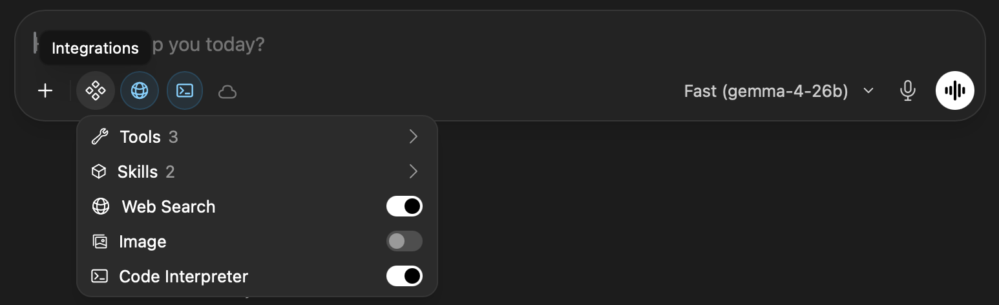
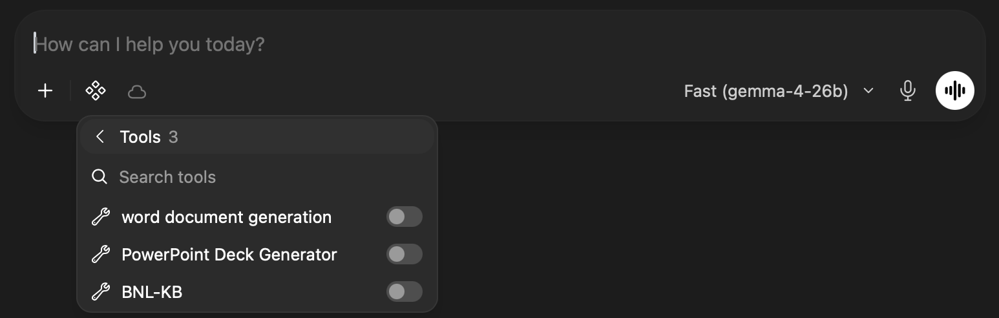
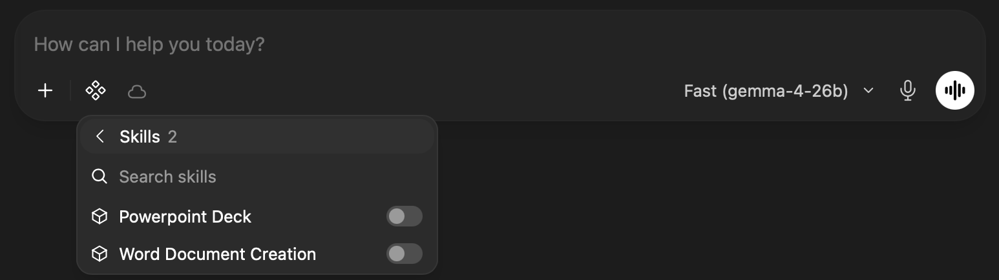
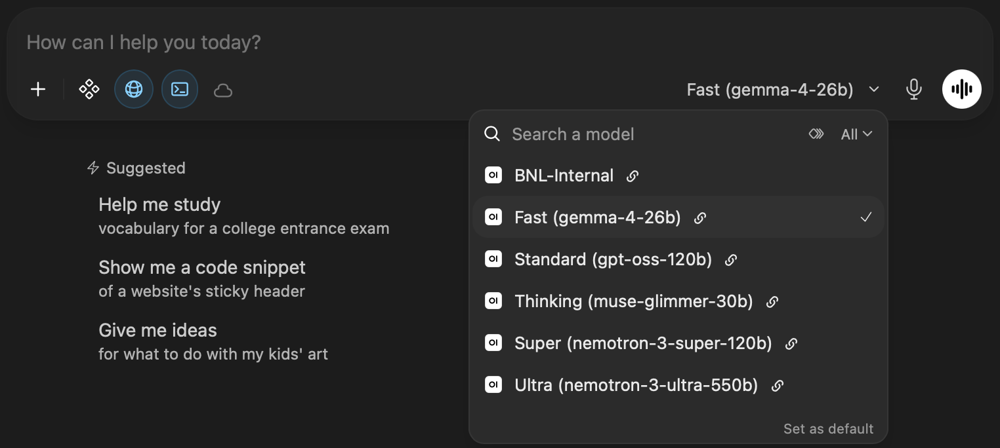

# Using BRAIN Chat

**BRAIN — BRookhAven INference** provides a browser-based chat interface
for working with open-weight large language models (LLMs) hosted on-site
at Brookhaven National Laboratory. Use BRAIN Chat for interactive
questions, writing and editing, code assistance, document analysis, and
other conversational model-assisted tasks.

This guide covers the chat interface and managing conversations, the
prompt-box features (attachments, integrations, and model selection), writing
effective prompts, and troubleshooting. For programmatic access or coding
agents, see the [coding agents guide](api.md).

> **Access** — BRAIN is available only on the BNL network or through the BNL
> VPN. Sign in with your Brookhaven Lab account.
>
> **Data handling** — Prompts and model outputs remain on BNL infrastructure
> and are never sent to external model providers. (Optional features such as
> Web Search may behave differently; see [Integrations](#22-integrations).)

### BRAIN endpoints

| Resource | URL |
|---|---|
| Chat Interface | [`https://chat.brain.bnl.gov`](https://chat.brain.bnl.gov) |
| API Service | [`https://api.brain.bnl.gov`](https://api.brain.bnl.gov) |
| API Key Manager | [`https://api.brain.bnl.gov/km/`](https://api.brain.bnl.gov/km/) |

---

## 1. Overview

Go to the BRAIN landing page and select **Start Chatting** (or **Chat** in the
top navigation), or open the [chat interface](#brain-endpoints) directly. After
sign-in, the main BRAIN Chat window opens.

BRAIN Chat is based on [Open WebUI](https://openwebui.com), an open-source chat
interface, and serves the models hosted on BRAIN. Its layout and many of its
features will therefore be familiar to Open WebUI users, and the Open WebUI
documentation can supplement this guide.

The interface has three main areas:

- **Left sidebar** — manage your chat history:
  - **New Chat** starts a separate conversation with a fresh context.
  - **Search** helps locate previous chats.
  - Existing chats appear in the sidebar and can be reopened.
  - **Notes** is an area for storing your own notes; you can create notes or
    upload text and Markdown (`.txt`, `.md`) files.
- **Prompt box** — enter your question or task and submit it to the selected
  model. Its controls are described in [Prompt Box](#2-prompt-box).
- **Model selector** — at the right of the prompt box; shows the active model
  and lets you switch to another model available in BRAIN (see
  [Model Selection](#23-model-selection)).

Start a new chat when you change to an unrelated task. This keeps the
conversation context focused and reduces the chance that earlier discussion
influences a new request. Very long conversations (or large attachments) can
also approach a model's context window; responses may become slower or less
focused, and requests that exceed the limit may fail.

Chats are stored in your account's chat history; delete any you no longer
need from the sidebar or **Settings → Data Controls**, depending on the
installed version.

**Settings and version information** — open the account menu in the lower-left
corner and select **Settings** to access interface, personalization,
notification, data, and account options. To see the installed BRAIN Chat /
Open WebUI version, go to **Settings → About**; include this version when
reporting a problem. The exact version and available settings may change as
the service is updated.

---

## 2. Prompt Box

Everything you can add to a request is controlled from the prompt box: the
**+** button for attachments, the **Integrations** button for tools and skills,
and the model selector at the right. Voice input is also available.

### 2.1 Attachments

Use the **+** control at the left of the prompt box to add supported files to
a conversation. Then tell the model what you want it to do with the file, such
as summarize it, extract information, compare sections, or answer questions
about its contents.

For long or complex documents, be explicit about the desired output and scope.
Image analysis requires a vision-capable model (see
[Model Selection](#23-model-selection)). Supported file types and size limits
may vary; if an upload is rejected, try a different format such as plain text
or PDF.

> **Sensitive data** — Even though data stays on BNL infrastructure, follow
> BNL's [Artificial Intelligence Policy](https://intranet.bnl.gov/itd/ai-policy.php)
> (*internal link*) and your data-classification rules when sharing files or
> information.

### 2.2 Integrations

Select the **Integrations** button (the four-diamond icon, left of the model
selector) to extend what the model can do in the current chat. **Web Search**
and **Code Interpreter** are on by default; tools, skills, and **Image** are
off until you switch them on. Toggles apply to the current chat and can be
changed at any time.



The menu contains:

| Item | Purpose |
|---|---|
| **Tools** | Opens a list of tools the model can call (see [Tools](#221-tools)). |
| **Skills** | Opens a list of skills that give the model task-specific instructions (see [Skills](#222-skills)). |
| **Web Search** | Lets the model look up information on the web. On by default. |
| **Image** | Enables image generation, which requires a model that supports it. |
| **Code Interpreter** | Lets the model run code to calculate or process data and use the result in its answer. On by default. |

> **Note** — Web Search may send your query to an external search service, in
> which case the BRAIN guarantee that prompts stay on BNL infrastructure would
> not apply to it. Turn it off for sensitive content. Available integrations
> and their defaults depend on how BRAIN is configured and may differ from this
> guide.

#### 2.2.1 Tools

Select **Tools** to see the list, and turn on the ones you need.



At the time of writing, the list includes:

- **word document generation** — create Word (`.docx`) documents from the
  conversation;
- **PowerPoint Deck Generator** — create PowerPoint (`.pptx`) presentations;
- **BNL-KB** — look up information in a BNL knowledge base.

After enabling a tool, describe the result you want in your prompt, for
example: *"Create a one-page Word summary of the points above."*

#### 2.2.2 Skills

Select **Skills** to see the available skills, and turn on only those relevant
to your task.



At the time of writing, the list includes **Powerpoint Deck** and **Word
Document Creation**. Skills provide the model with guidance on how to produce a
particular kind of output, and are typically used together with the matching
tool above.

> **Tip** — Enable only what you need. Fewer active integrations make it
> easier for the model to pick the right one. If a tool is not called or fails,
> try a different model or rephrase the request.

### 2.3 Model Selection

Select the model name at the right of the prompt box to open the model list.
You can type in the **Search a model** field to filter it, and use **Set as
default** to change the model used for new chats.



The models shown in BRAIN may change over time. Choose a model based on the
task rather than relying on a fixed list in this guide. At the time of writing,
the selector offers friendly names that map to underlying models, for example:

| Selector&nbsp;name | Underlying&nbsp;model&nbsp;name | Good for |
|---|---|---|
| **Fast**&nbsp;(default) | `gemma-4-26b` | Routine questions, summarization, drafting; understands images |
| **Standard** | `gpt-oss-120b` | General text and code; reasons before answering |
| **Thinking** | `muse-glimmer-30b` | Step-by-step reasoning; understands images |
| **Super** | `nemotron-3-super-120b` | Multi-step problems and coding; long context |
| **Ultra** | `nemotron-3-ultra-550b` | Hardest analysis and coding tasks; highest benchmark scores |
| **BNL&#8209;Internal** | `bnl-nemotron-3` | Lab policies and procedures, per the Standards Based Management System (SBMS); not for general tasks |

Other models may also be listed, such as image-generation models. Embedding
models are intended for retrieval and API use, not chat. Choose **BNL-Internal**
only for questions about Brookhaven Lab policies and procedures; use the
general-purpose models above for everything else. For model details and
benchmark results, see the **Leaderboard** on the BRAIN landing page.

Typical choices include:

- a **fast/general-purpose** model for routine questions, summarization, and
  drafting;
- a **larger or reasoning-oriented** model for more difficult analysis or
  coding tasks;
- a **vision-capable** model when working with images or image-containing
  documents.

If you are unsure, start with the default model and switch only when the task
calls for a different capability. Reasoning models may take longer to respond.

> **Important** — The model selector in BRAIN Chat is the authoritative list
> of models currently available to you.

---

## 3. Prompting Tips

Select **New Chat**, then type your request in the prompt box. You can
continue the conversation with follow-up questions; the model uses the current
chat history as context.

State the task clearly and include the context the model needs. For example:

```text
Summarize the following text in five bullets for a technical audience.
```

```text
Review this Python function for correctness and performance. Explain any
issues before suggesting changes.
```

```text
Draft a concise project update from these notes. Keep the tone professional
and factual.
```

A good prompt usually contains three things: **task**, **context**, and
**desired output**.

```text
Task: Explain the error in this traceback.
Context: This is a Python data-processing script using pandas.
Output: Give the likely cause first, then a minimal fix, then any edge cases
I should check.
```

Useful practices:

- Provide relevant text, code, data, or files instead of assuming the model
  knows your local context.
- Specify the intended audience, format, and level of detail.
- Ask the model to state assumptions when information is incomplete.
- For technical or scientific work, verify important claims, calculations,
  citations, and generated code before relying on them. Models can produce
  plausible but incorrect or fabricated answers, including references.
- Break large tasks into stages when you need more control over the result.
- Refine iteratively: if the answer is off, say what to change rather than
  repeating the request.
- Start a new chat when you change to an unrelated task.
- Do not ask the model which model it is; it may answer incorrectly. Use the
  model selector as the source of truth.

---

## 4. Troubleshooting

### BRAIN Chat does not open

Confirm that you are connected to the **BNL network or BNL VPN**, then reload
the page and sign in again if needed.

### I cannot sign in

Use your Brookhaven Lab account credentials. If sign-in still fails, contact
support (see below).

### A model I used before is missing

The available model set can change. Open the **model selector** and choose
from the models currently listed.

### An attached file or image is not handled

Check that the file type is supported, and use a vision-capable model for
images. If the file is large, attach a smaller excerpt.

### A tool or skill does not work

Confirm it is switched on in the **Integrations** menu, then state clearly in
your prompt what output you want. If it still fails, try another model or start
a new chat.

### The response is slow or incomplete

Try one or more of the following:

- resend the request;
- start a new chat if the current conversation is very long;
- reduce the amount of material requested in a single prompt;
- choose another available model appropriate for the task.

### I need to report a problem

Use the **Contact Support** link in the footer of the BRAIN landing page and
include enough detail to reproduce the issue, such as what you were doing,
which model was selected, the Open WebUI version, and any error message shown.
Do not include passwords, API keys, or other secrets.

---

## Quick-Reference Checklist

Use this as a pre-flight check before starting a chat:

- [ ] Connected to the BNL network (or VPN)
- [ ] Signed in with your Brookhaven Lab account
- [ ] Selected an appropriate model
- [ ] Reviewed which integrations (Web Search, Code Interpreter, tools) are on
- [ ] Included the context or files needed for the task
- [ ] Specified the desired output when the task is nontrivial
- [ ] Verified important technical or scientific results before use
