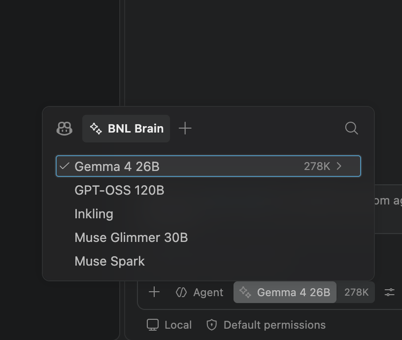

# Using BRAIN Models in VS Code Chat

**BRAIN — BRookhAven INference** provides access to open-weight large language
models hosted on-site at Brookhaven National Laboratory through an
OpenAI-compatible API. This guide shows you how to configure Visual Studio
Code's built-in **Chat** panel, **inline chat**, and **Agent mode** to use BRAIN
models (such as Gemma, GPT-OSS, Muse, and Nemotron) in about 10 minutes.

For terminal-based coding assistants (Claude Code, OpenAI Codex CLI, and
OpenCode), see the [coding agents guide](agents.md). For direct programmatic
access (`curl` and Python), see the [API guide](api.md); for browser-based
conversations, see the [chat guide](chat.md).

> **Access** — BRAIN is available only on the BNL network or through the BNL
> VPN. Sign in with your Brookhaven Lab account to manage API keys.
>
> **Data handling** — Prompts, code context, and model outputs sent to BRAIN
> remain on BNL infrastructure and are never sent to external model providers.

### BRAIN endpoints

| Resource | URL |
|---|---|
| Chat Interface | [`https://chat.brain.bnl.gov`](https://chat.brain.bnl.gov) |
| API Service | [`https://api.brain.bnl.gov`](https://api.brain.bnl.gov) |
| API Key Manager | [`https://api.brain.bnl.gov/km/`](https://api.brain.bnl.gov/km/) |

---

## 1. Prerequisites

Make sure you have the following before configuring VS Code:

- **Visual Studio Code**, updated to a recent version (**Code → Check for
  Updates…** on macOS, or **Help → Check for Updates…** on Windows and Linux).
- **VS Code Chat enabled** — Recent versions of VS Code let you add custom
  language model endpoints directly from the Chat panel without signing in to
  GitHub. If an older VS Code build prompts you to sign in to unlock Chat, a
  free GitHub Copilot sign-in is sufficient.
- **A BRAIN API key** — Generate your key in the **BRAIN API Key Manager**
  ([BRAIN endpoints](#brain-endpoints)). For step-by-step instructions, see
  [Obtaining and Configuring a BRAIN API Key](api-key.md).
- **Access to the BNL network** — Connect on-site or through the **BNL VPN**.

---

## 2. Check Which Models Your Key Can Use

This step is optional, but it confirms that your API key works and shows the
exact model `id` values currently available on BRAIN:

1. Open a terminal, run the command below, and press **Enter**. At the prompt,
   paste your BRAIN API key and press **Enter** again (typing is hidden so the
   key stays out of your terminal display and shell history):

   ```bash
   printf "BRAIN API Key: " && read -rs BRAIN_API_KEY && echo && export BRAIN_API_KEY
   ```

2. Query the `/v1/models` endpoint to list the available model IDs:

   ```bash
   curl -sS https://api.brain.bnl.gov/v1/models \
     -H "Authorization: Bearer $BRAIN_API_KEY" | python3 -m json.tool
   ```

3. Compare the `"id"` values in the output with the model configuration in
   [Paste the Model Configuration](#4-paste-the-model-configuration) and remove
   any model that is not listed for your key.

> **Note** — `nomic-embed-text` is an embedding model for vector search and
> cannot be used in VS Code Chat.

---

## 3. Add BRAIN as a Custom Endpoint

1. Open the **Chat** view in VS Code using `Ctrl+Cmd+I` (macOS) or `Ctrl+Alt+I`
   (Windows/Linux).
2. Click the **model picker** dropdown at the bottom of the chat input box, then
   click the **`+`** (**Add Models**) button — or select **Manage Models…** to
   open the **Language Models** pane, click **Add Models**, and select **Custom
   Endpoint** *(menu wording varies slightly across VS Code versions)*.
3. When prompted for a **Group Name**, enter `BNL BRAIN` (or `BNL Brain`).
4. When prompted for an **API Key**, paste your BRAIN API key and press
   **Enter**. VS Code saves the key in its secure credential storage.
5. If prompted for the **API Type** (endpoint format), select **Chat
   Completions**.
6. VS Code opens the language models configuration file (`JSON`). Keep this file
   open for [Paste the Model Configuration](#4-paste-the-model-configuration).

In that file, VS Code writes an `"apiKey"` line that looks like:

```json
"apiKey": "${input:chat.lm.secret.xxxxxxxx}"
```

This is a pointer to your stored key in VS Code's secret storage, and the ID is
unique to your machine. Keep your generated `"apiKey"` line unchanged.

---

## 4. Paste the Model Configuration

In the open language models JSON file, populate the `"models"` array inside your
`BNL BRAIN` group entry with the models confirmed in
[Check Which Models Your Key Can Use](#2-check-which-models-your-key-can-use):

```json
"models": [
  {
    "id": "gemma-4-26b",
    "name": "Gemma 4 26B",
    "url": "https://api.brain.bnl.gov/v1/chat/completions",
    "toolCalling": true,
    "vision": true,
    "maxInputTokens": 262144,
    "maxOutputTokens": 16000
  },
  {
    "id": "gpt-oss-120b",
    "name": "GPT-OSS 120B",
    "url": "https://api.brain.bnl.gov/v1/chat/completions",
    "toolCalling": true,
    "vision": false,
    "maxInputTokens": 131072,
    "maxOutputTokens": 16000
  },
  {
    "id": "nemotron-3-super-120b",
    "name": "Nemotron 3 Super 120B",
    "url": "https://api.brain.bnl.gov/v1/chat/completions",
    "toolCalling": true,
    "vision": false,
    "maxInputTokens": 1048576,
    "maxOutputTokens": 16000
  },
  {
    "id": "nemotron-3-ultra-550b-nvfp4",
    "name": "Nemotron 3 Ultra 550B",
    "url": "https://api.brain.bnl.gov/v1/chat/completions",
    "toolCalling": true,
    "vision": false,
    "maxInputTokens": 524288,
    "maxOutputTokens": 16000
  },
  {
    "id": "nemotron-3.5-lightning",
    "name": "Nemotron 3.5 Lightning",
    "url": "https://api.brain.bnl.gov/v1/chat/completions",
    "toolCalling": true,
    "vision": false,
    "maxInputTokens": 1048576,
    "maxOutputTokens": 16000
  },
  {
    "id": "muse-spark-open",
    "name": "Muse Spark",
    "url": "https://api.brain.bnl.gov/v1/chat/completions",
    "toolCalling": true,
    "vision": false,
    "maxInputTokens": 1048576,
    "maxOutputTokens": 16000
  },
  {
    "id": "muse-glimmer-30b",
    "name": "Muse Glimmer 30B",
    "url": "https://api.brain.bnl.gov/v1/chat/completions",
    "toolCalling": true,
    "vision": false,
    "maxInputTokens": 131072,
    "maxOutputTokens": 16000
  }
]
```

### Configuration Fields

| Field | What it does |
|---|---|
| `id` | Exact model identifier expected by BRAIN. Must match an `id` from `/v1/models` in [Check Which Models Your Key Can Use](#2-check-which-models-your-key-can-use). |
| `name` | Display label shown in the VS Code Chat model picker. You can change this freely. |
| `url` | OpenAI-compatible Chat Completions endpoint on BRAIN (`https://api.brain.bnl.gov/v1/chat/completions`). |
| `apiType` | If present in your file, must be set to the `chat-completions` format because BRAIN is OpenAI-compatible. If VS Code flags the value, choose the chat-completions option suggested by autocomplete. |
| `toolCalling` | Allows the model to appear and call workspace tools in **Agent mode**. Set to `false` if a model fails during tool calling. |
| `vision` | Allows attaching images in Chat. Enabled for `gemma-4-26b` by default (can also be set to `true` for other vision-capable models such as `muse-glimmer-30b`). |
| `maxInputTokens` | Maximum input context size (in tokens), taken from `max_input_tokens` in BRAIN's `/v1/models` list. |
| `maxOutputTokens` | Maximum number of output tokens per completion (for example, `16000`). |

> **Tip** — As models are added or updated on BRAIN, re-run the `curl` command
> in [Check Which Models Your Key Can Use](#2-check-which-models-your-key-can-use)
> to check the current model list. You can reopen the configuration file at any
> time from the Command Palette (`Cmd+Shift+P` on macOS or `Ctrl+Shift+P` on
> Windows/Linux) by running **Chat: Open Language Models (JSON)**.

---

## 5. Reload and Pick a Model

1. Save the language models JSON file (`Cmd+S` on macOS or `Ctrl+S` on
   Windows/Linux).
2. Reload VS Code: open the Command Palette (`Cmd+Shift+P` on macOS or
   `Ctrl+Shift+P` on Windows/Linux) and run **Developer: Reload Window**.
3. Open **Chat** and click the model dropdown at the bottom of the chat box.
4. Select your **BNL Brain** (or **BNL BRAIN**) group and pick a model, such as
   **Gemma 4 26B**.



The model you select is used across the **Chat** panel, **inline chat**
(`Cmd+I` on macOS or `Ctrl+I` on Windows/Linux inside an editor), and **Agent
mode**.

---

## 6. Troubleshooting

| Symptom | Likely Cause | Fix |
|---|---|---|
| Configured models do not appear in the Chat model picker | File was not saved, contains a JSON syntax error (such as a trailing comma), or the window was not reloaded | Check the JSON file for red squiggles (`Cmd+Shift+P` / `Ctrl+Shift+P` → **Chat: Open Language Models (JSON)**), save it, and run **Developer: Reload Window**. |
| `401 Unauthorized` or authentication error in Chat | Stored API key is invalid, expired, or was regenerated | Re-add or update the secret in **Language Models** using an active key from the **BRAIN API Key Manager** ([API key guide](api-key.md)). |
| Request times out or fails to connect | Not connected to the BNL network | Connect to the **BNL VPN** and verify reachability with the `curl` check in [Check Which Models Your Key Can Use](#2-check-which-models-your-key-can-use). |
| Model fails when used in **Agent mode** | Model encountered a tool-calling formatting issue | Switch to another model (such as `gemma-4-26b` or `nemotron-3-ultra-550b-nvfp4`) or set `"toolCalling": false` for that model to use it in standard Ask/Chat mode. |
| Cannot attach images in Chat | Selected model has `"vision": false` | Switch to `Gemma 4 26B` (or set `"vision": true` on another vision-capable model such as `muse-glimmer-30b`). |

---

## Quick-Reference Checklist

Use this as a pre-flight check when setting up VS Code Chat with BRAIN:

- [ ] Connected to the BNL network (or BNL VPN)
- [ ] VS Code updated to a recent version
- [ ] API key generated at the **BRAIN API Key Manager** ([API key guide](api-key.md))
- [ ] Custom endpoint group (`BNL BRAIN`) added via **Manage Models** / **Add Models**
- [ ] `"models"` list saved in **Chat: Open Language Models (JSON)** with valid JSON
- [ ] VS Code reloaded via **Developer: Reload Window**
- [ ] BRAIN model selected in the Chat model picker
